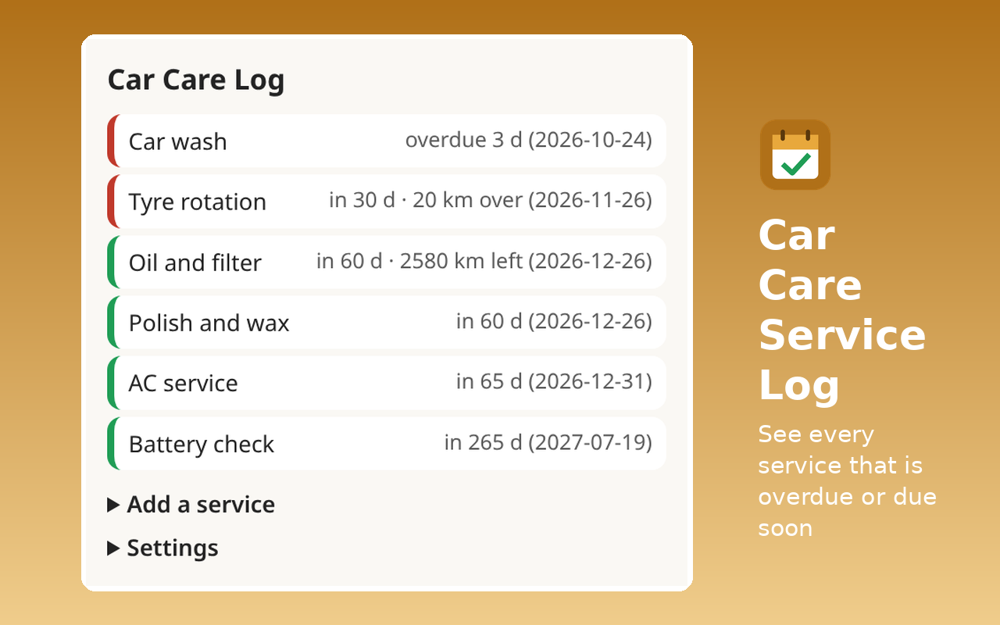

# Car Care Service Log

Log washes, oil changes, tyres, AC and more, see what is overdue or due soon, and get one daily reminder. Data stays in your browser.



## Layout
- `src/`: the extension (plain HTML, CSS and JavaScript, no dependencies, no build step). `lib.js` holds the logic and is unit-tested.
- `test/lib.test.js`: unit tests.
- `dist/car-care-log-firefox.zip` and `dist/car-care-log-edge.zip`: upload packages made by `../_tools/build.py` (the two differ only in `manifest.json`).
- `store/`: screenshots (1280×800), small promo tile (440×280) and 300×300 logo.
- `LISTING.md`: every store field. `NOTES_FOR_CERTIFICATION.md`: the Edge reviewer notes.

## Permissions
| Permission | Why |
|---|---|
| `storage` | Keeps the service log, the current odometer and the date of the last reminder in local extension storage. |
| `alarms` | Schedules one repeating 24-hour alarm that runs the due-date check. |
| `notifications` | Shows the single daily "Car care reminder" notification when a service is overdue or due within 7 days. |

Network: None. The extension makes no network requests and has no host permissions.

## Develop and test
```
node --test extensions/car-care-log/test/
python extensions/_tools/build.py car-care-log
web-ext lint -s extensions/car-care-log/build/firefox
```
8 `node:test` cases (date maths, latest-per-type, overdue by days and by km, custom intervals, soon threshold, notification text, CSV escaping, form validation).

Licence: MIT.
