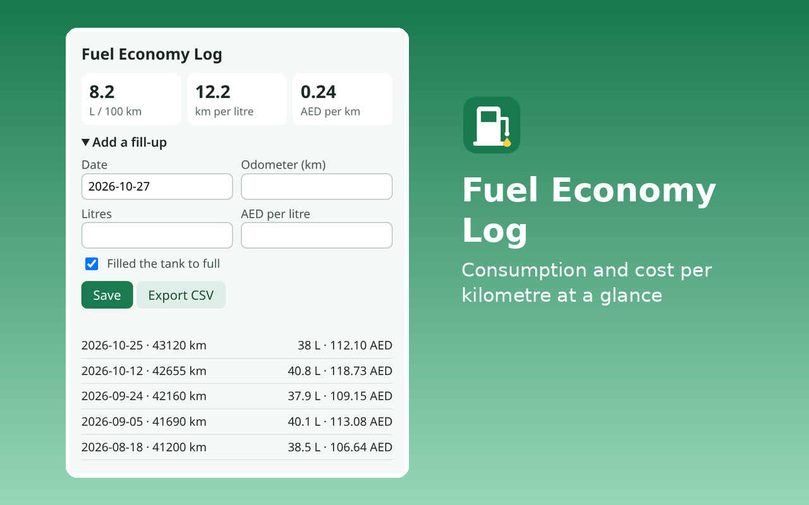

# Fuel Economy Log

Log fill-ups to see litres per 100 km, km per litre and AED per km. Works offline and keeps your data in your browser.



## Layout
- `src/`: the extension (plain HTML, CSS and JavaScript, no dependencies, no build step). `lib.js` holds the logic and is unit-tested.
- `test/lib.test.js`: unit tests.
- `dist/fuel-economy-log-firefox.zip` and `dist/fuel-economy-log-edge.zip`: upload packages made by `../_tools/build.py` (the two differ only in `manifest.json`).
- `store/`: screenshots (1280×800), small promo tile (440×280) and 300×300 logo.
- `LISTING.md`: every store field. `NOTES_FOR_CERTIFICATION.md`: the Edge reviewer notes.

## Permissions
| Permission | Why |
|---|---|
| `storage` | Stores the list of fill-ups (date, odometer, litres, optional price) in local extension storage. |

Network: None. The extension makes no network requests and has no host permissions.

## Develop and test
```
node --test extensions/fuel-economy-log/test/
python extensions/_tools/build.py fuel-economy-log
web-ext lint -s extensions/fuel-economy-log/build/firefox
```
9 `node:test` cases (segments, partial fills, summary totals, best and worst, unsorted input, monthly spend, validation, CSV).

Licence: MIT.
