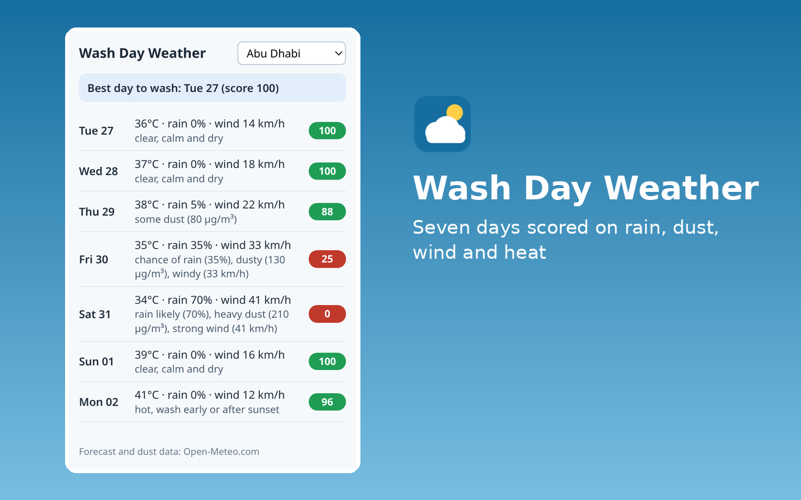

# Wash Day Weather

Seven-day car wash planner for the UAE. Scores every day on rain, dust, wind and heat and shows the best day to wash.



## Layout
- `src/`: the extension (plain HTML, CSS and JavaScript, no dependencies, no build step). `lib.js` holds the logic and is unit-tested.
- `test/lib.test.js`: unit tests.
- `dist/wash-day-weather-firefox.zip` and `dist/wash-day-weather-edge.zip`: upload packages made by `../_tools/build.py` (the two differ only in `manifest.json`).
- `store/`: screenshots (1280×800), small promo tile (440×280) and 300×300 logo.
- `LISTING.md`: every store field. `NOTES_FOR_CERTIFICATION.md`: the Edge reviewer notes.

## Permissions
| Permission | Why |
|---|---|
| `storage` | Remembers the selected city between sessions (one short string). Nothing else is stored. |

Network: The popup calls `https://api.open-meteo.com/v1/forecast` and `https://air-quality-api.open-meteo.com/v1/air-quality` (both send CORS headers, so no host permission is needed). The request contains the fixed latitude and longitude of the chosen city. No cookies, identifiers or user data are sent.

## Develop and test
```
node --test extensions/wash-day-weather/test/
python extensions/_tools/build.py wash-day-weather
web-ext lint -s extensions/wash-day-weather/build/firefox
```
9 `node:test` cases (scoring tiers, clamping, dust aggregation, merging both feeds, best-day choice, weekday, URLs, empty input).

Licence: MIT.
